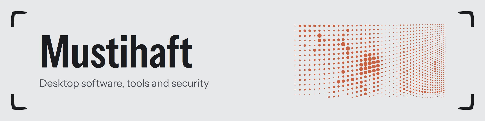
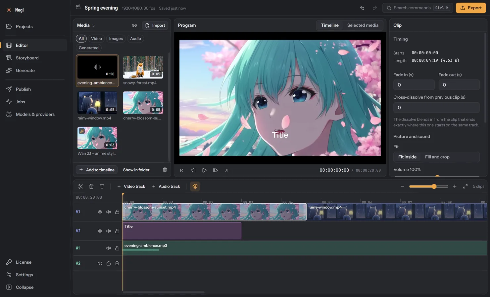

<picture>
  <source media="(prefers-color-scheme: dark)" srcset="assets/negi-banner-dark.webp">
  
</picture>

I build desktop software, developer tools and automation, with a strong interest in security.
My main project right now is **Negi**.

## Negi

A Windows app for making AI video on your own PC. A language model drafts the script and
scenes, an open video model renders each scene on the graphics card, and a multi-track editor
cuts everything together.

- Electron, React and TypeScript, with FFmpeg for import checks and export
- Local models through ComfyUI (Wan 2.1) and Ollama; generation tested on an RTX 3060 Ti
- Ed25519-signed licenses with an online license service and offline grace period
- Hardened Electron build: sandboxed renderer, strict content security policy, locked fuses

**[Website and download](https://mustihaft.github.io/negi/)** &nbsp;|&nbsp;
[Releases](https://github.com/Mustihaft/negi/releases) &nbsp;|&nbsp;
[Report a bug](https://github.com/Mustihaft/negi/issues)

## Focus

Systems, security, automation and the web.

## Tools

| Area | Tools |
| --- | --- |
| Languages | TypeScript, JavaScript, Python |
| Desktop and web | Electron, React, Node.js, Fastify |
| Media and AI | FFmpeg, ComfyUI, Ollama |
| Workflow | Git, Linux, Windows, VS Code |

  

